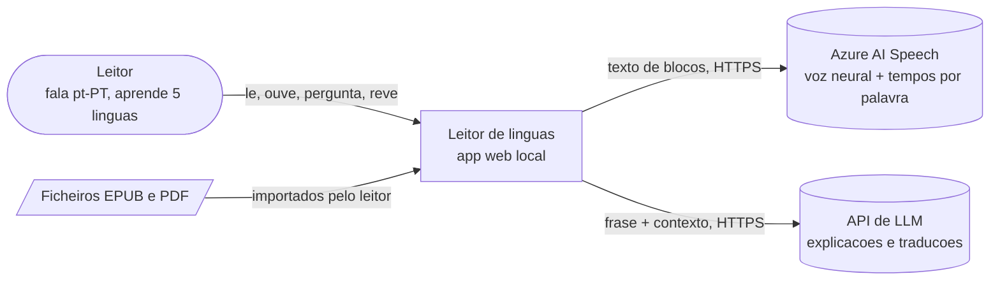
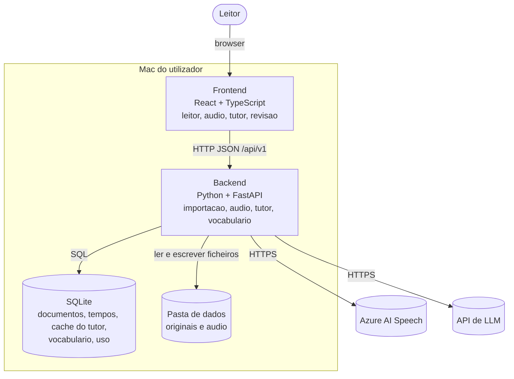

# Leitor de línguas — proposta de arquitetura

11 de novembro de 2026 · João Miguel Gomes

## Resumo

Recomendo um monólito modular a correr no teu Mac: backend FastAPI (Python), frontend React (TypeScript), SQLite e ficheiros em disco. A voz vem do Azure AI Speech e o tutor de um LLM de baixo custo, ambos atrás de interfaces próprias para poderem ser trocados.

O custo esperado é de 0 a 10 € por mês em uso pessoal. O áudio de um livro por mês cabe no escalão gratuito do Azure; o tutor custa cêntimos.

**Pressupostos tirados das tuas respostas**

- Corre em macOS, como app web local aberta no browser, só para ti.
- EPUB e PDF com texto; PDFs digitalizados ficam para depois.
- Não precisas de arranque imediato do áudio, por isso gero por blocos e guardo em cache.
- Projeto recreativo, sem data-alvo, com repositório provavelmente público.
- Alguns documentos podem ser pessoais, por isso há uma marca "privado" por documento.
- A versão web multiutilizador é um cenário futuro: não a construo agora, mas não a bloqueio.

**O que é necessário agora, mais tarde ou nunca**

| Tema | Necessário agora | Mais tarde (app web) | Desnecessário |
| --- | --- | --- | --- |
| Aplicação | Um processo backend + frontend estático | Alojamento, HTTPS, domínio | Microserviços, Kubernetes |
| Dados | SQLite + pasta de ficheiros | Postgres + armazenamento de objetos | Várias bases de dados |
| Cache | Tabelas SQLite + ficheiros de áudio | Cache partilhada entre utilizadores | Redis |
| Trabalho em fundo | Tarefas no próprio processo + tabela de jobs | Fila com workers | Arquitetura orientada a eventos |
| Acesso | Servidor só em 127.0.0.1 | Contas, sessões, quotas, pagamentos | Autenticação na fase local |
| Observabilidade | Logs estruturados + página de custos | Métricas e alertas externos | Tracing distribuído |

**Quatro escolhas baratas que mantêm a porta aberta para a web**

1. Frontend e backend já falam por uma API HTTP versionada, como numa app web.
2. Ficheiros e áudio passam por uma interface de armazenamento, hoje disco, amanhã objetos.
3. Voz e LLM ficam atrás de interfaces, sem código do fornecedor espalhado pela app.
4. O SQL fica compatível com Postgres, através de SQLAlchemy e migrações Alembic.

## Arquitetura de alto nível

Um único processo backend faz tudo: importa documentos, gera e serve áudio, responde ao tutor e guarda o vocabulário. O browser mostra o leitor e fala só com esse backend; as chaves de API nunca chegam ao frontend.

**Porquê monólito modular.** Há um utilizador, uma máquina e um programador. Microserviços e serverless acrescentam deploy, rede e monitorização sem resolver nenhum problema que tenhas. Os módulos internos (importação, áudio, tutor, vocabulário, armazenamento) têm fronteiras claras, o que permite separar um deles mais tarde se houver razão.

**Fluxos principais**

1. **Importar.** O ficheiro é validado, o texto é extraído e limpo, e depois dividido em capítulos, blocos, frases e palavras com posições. A língua é detetada localmente. Nada sai do portátil neste passo.
2. **Ouvir.** O leitor pede o áudio de um bloco (alguns parágrafos). Se existir em cache, é servido de imediato. Se não, o backend chama o Azure, recebe o áudio e o tempo de cada palavra, e guarda ambos.
3. **Destacar.** O frontend compara o tempo atual do áudio com os tempos guardados e acende a palavra certa. Repetir ou saltar frase é mover o áudio para o tempo de início dessa frase.
4. **Velocidade.** De 0,5x a 1,5x é feita no browser, sobre o mesmo ficheiro. Mudar a velocidade não gera áudio novo nem custa nada.
5. **Perguntar.** Ao carregar numa palavra ou selecionar uma frase, o backend envia a frase e o contexto próximo ao LLM, com um formato de resposta fixo em JSON. A resposta fica em cache.
6. **Rever.** As palavras guardadas entram num algoritmo de repetição espaçada que corre localmente, sem serviços externos.

**Autenticação.** Não existe nesta fase. O servidor escuta apenas em 127.0.0.1 e valida o cabeçalho Host. Na fase web entram contas e sessões; a secção de segurança diz o que muda.

**O que acontece quando um componente externo falha**

| Componente | Falha | Comportamento da app |
| --- | --- | --- |
| Azure AI Speech | Indisponível ou quota gratuita esgotada | Blocos já em cache continuam a tocar; os restantes mostram erro claro e botão de repetir |
| LLM | Indisponível, lento ou resposta inválida | Leitura e áudio continuam; o painel do tutor mostra o erro; respostas em cache continuam visíveis |
| Internet | Sem ligação | Importar, ler, ouvir o que está em cache e rever vocabulário funcionam |
| Resposta do LLM fora do formato | JSON inválido | Uma nova tentativa; se falhar, erro visível e nada é guardado em cache |

## Decisões com trade-offs

Seis decisões moldam o projeto; a da voz é a mais cara de reverter, por isso fica isolada atrás de uma interface.

| Decisão | Recomendado | Alternativa viável | Vantagens e desvantagens | Rever quando | Risco principal |
| --- | --- | --- | --- | --- | --- |
| Estilo | Monólito modular num processo | Serverless por função | Simples de correr, depurar e aprender; não escala horizontalmente sem trabalho | Houver utilizadores reais na web e um módulo a saturar | Módulos a misturarem-se se as fronteiras não forem respeitadas |
| Voz | Azure AI Speech, vozes Neural | Modelo local (Kokoro) + alinhamento forçado | Azure dá tempos por palavra nas cinco línguas e 0,5 M de caracteres grátis por mês; depende de rede e de um fornecedor. O local é gratuito e privado, mas só dá tempos por palavra em inglês | Leres mais de um livro por mês, ou quiseres modo offline | Custo por carácter se a cache falhar ou o volume subir |
| LLM do tutor | Modelo do escalão mais barato, atrás de interface própria, com saída JSON | Modelo local (Ollama) | Custa cêntimos e responde bem a tarefas curtas; o texto sai do portátil. O local é privado, mas mais fraco em explicações em pt-PT | As explicações falharem num conjunto de teste de 20 frases por língua | Explicações erradas ditas com confiança |
| Dados | SQLite (modo WAL) + ficheiros em disco | Postgres desde o início | Zero instalação e backup por cópia de pasta; um só escritor de cada vez. Postgres obriga a correr um serviço sem ganho hoje | Passares a app web multiutilizador | SQL específico de SQLite dificultar a migração |
| Forma da app | App web local em localhost | App desktop (Tauri) | Reaproveita quase tudo na versão web e não exige empacotar; tens de arrancar o servidor à mão | Quiseres distribuir a app local a outras pessoas | Nenhum relevante nesta fase |
| Geração de áudio | Por bloco, a pedido, com pré-geração opcional de capítulo após estimativa de custo | Livro inteiro em lote na importação | Pagas só o que ouves e o primeiro bloco chega em segundos; pode haver uma pausa curta entre blocos se a rede estiver lenta | As pausas incomodarem | Gastar quota em livros que abandonas, se optares pelo lote |

**Qual LLM, em concreto.** Os modelos mais baratos da OpenAI, Google e Anthropic custam todos entre 0,05 e 0,10 USD por milhão de tokens de entrada. A este volume a diferença de preço é irrelevante. Escolhe pelo resultado: corre as mesmas 20 frases por língua em dois modelos e fica com o que explica melhor em pt-PT.

**Porque não há alternativa melhor ao Azure para já.** O requisito que decide é o destaque palavra a palavra em cinco línguas. O Azure entrega esses tempos de origem e o escalão gratuito cobre cerca de um livro por mês. Alternativas com voz mais natural existem, mas custam mais ou obrigam a calcular os tempos à parte.

## Segurança desde o início

Na fase local os riscos reais são três: chaves de API num repositório público, ficheiros maliciosos na importação e texto pessoal enviado para a cloud. Login, pagamentos e área administrativa não existem ainda.

**Controlos a implementar agora**

- **Acesso.** O servidor escuta só em 127.0.0.1, valida o cabeçalho Host e não aceita CORS de outras origens. Isto impede que um site aberto no browser chame a tua API local.
- **Segredos.** As chaves vivem num ficheiro `.env` fora do git, com `.env.example` no repositório. Um verificador de segredos (gitleaks) corre antes de cada commit. As chaves nunca são enviadas ao frontend nem escritas em logs.
- **Limite de gasto.** O recurso Azure fica no escalão gratuito, que não acumula custos. A chave do LLM é exclusiva deste projeto e tem teto mensal definido no fornecedor. A app tem ainda um teto próprio configurável.
- **Menor privilégio.** O processo corre com o teu utilizador e só escreve na pasta de dados da app. Cada chave dá acesso a um único serviço.
- **Validação no servidor.** Todos os pedidos são validados com Pydantic. Os uploads têm limite de tamanho e o tipo é verificado pelo conteúdo, não pela extensão.
- **Ficheiros não confiáveis.** Um EPUB é um ZIP: limito o tamanho descomprimido e rejeito caminhos que saiam da pasta. O HTML do livro nunca é mostrado tal como vem; extraio texto e estrutura.
- **Texto do livro como instrução.** Um documento pode conter frases que tentam mandar no LLM. O tutor não tem ferramentas nem acesso a dados, e a resposta é mostrada como texto, por isso o impacto é baixo.
- **Documentos privados.** Cada documento tem uma marca "privado". Com ela ativa, a app pede confirmação antes do primeiro envio de texto para a voz ou para o tutor, e mostra o que vai sair.
- **Encriptação.** Em trânsito, todas as chamadas a fornecedores usam HTTPS. Em repouso, conto com o FileVault do macOS; não cifro nada ao nível da app.
- **Repositório público.** A pasta de dados (livros, áudio, base de dados) fica fora do repositório e no `.gitignore`. Livros com direitos de autor não entram nos testes; uso textos em domínio público.

**Threat model breve**

| Área | Ameaça | Mitigação agora | Na fase web |
| --- | --- | --- | --- |
| Chaves de API | Fuga por commit, log ou frontend | `.env` fora do git, gitleaks, tetos de gasto | Gestor de segredos da plataforma, rotação |
| Importação | ZIP-bomba, caminho malicioso, HTML com script | Limites, validação de caminhos, extração só de texto | Processamento isolado e quotas por utilizador |
| API local | Site externo a chamar localhost | Só 127.0.0.1, validação de Host, sem CORS | HTTPS, sessões, proteção CSRF, limites de pedidos |
| Dados pessoais | Texto de documentos pessoais enviado a terceiros | Marca "privado" com confirmação | Política de privacidade, RGPD, eliminação de conta |
| Login | Não existe | Não aplicável | Fornecedor de identidade gerido, sem palavras-passe próprias |
| Pagamentos | Não existem | Não aplicável | Fornecedor de pagamentos; a app nunca vê dados de cartão |
| Área administrativa | Não existe | Não aplicável | Papel separado, registo de ações, acesso mínimo |

**Backups e recuperação.** Tudo o que importa está numa pasta: base de dados, originais e áudio. A app faz uma cópia consistente da base de dados uma vez por dia e antes de cada migração, e guarda as últimas sete. A pasta deve estar incluída no Time Machine. Recuperar é repor a pasta; convém testar isto uma vez. O áudio pode ser regenerado, mas custa quota, por isso entra no backup.

## Dados e API

A base de dados SQLite é a fonte de verdade de tudo exceto dos ficheiros binários, que vivem em disco e são referenciados por caminho e hash.

**Entidades principais**

| Entidade | O que guarda | Relações | Fonte de verdade |
| --- | --- | --- | --- |
| Documento | Título, autor, língua, formato, hash do ficheiro, marca "privado" | Tem muitos capítulos | SQLite; o original fica em disco |
| Capítulo | Título e ordem | Pertence a um documento; tem muitos blocos | SQLite |
| Bloco | Alguns parágrafos de texto limpo; unidade de síntese de áudio | Pertence a um capítulo; tem muitas frases | SQLite |
| Frase | Texto, posição no bloco, posições das palavras | Pertence a um bloco | SQLite |
| Áudio | Voz, hash do conteúdo, duração, tempos por palavra | Um por bloco e voz | SQLite para metadados e tempos; ficheiro em disco |
| Resposta do tutor | Tipo de pedido, modelo, versão do prompt, resposta JSON | Ligada a uma frase | SQLite |
| Entrada de vocabulário | Palavra, lema, tradução, frase original | Ligada a frase e documento | SQLite |
| Estado de revisão | Próxima data, intervalo, facilidade, histórico | Um por entrada de vocabulário | SQLite |
| Posição de leitura | Última frase ouvida | Uma por documento | SQLite |
| Registo de uso | Caracteres sintetizados, tokens, custo estimado, acertos de cache | Ligado ao documento | SQLite |

A chave de cache é um hash do conteúdo. Para áudio: texto do bloco, voz e versão do processo de limpeza. Para o tutor: frase, palavra ou seleção, tipo de pedido, modelo e versão do prompt. Mudar o prompt invalida a cache de forma explícita, sem apagar nada.

**Contratos de API principais** (prefixo `/api/v1`)

| Método e caminho | Função |
| --- | --- |
| `POST /documents` | Importar EPUB ou PDF; devolve o documento e o estado do processamento |
| `GET /documents` | Biblioteca, paginada |
| `GET /documents/{id}` · `PATCH` · `DELETE` | Detalhe, corrigir língua ou marca "privado", eliminar |
| `GET /documents/{id}/chapters/{n}` | Texto do capítulo com blocos, frases e palavras |
| `PUT /documents/{id}/position` | Guardar a frase onde paraste |
| `POST /blocks/{id}/audio` | Obter ou gerar o áudio do bloco; devolve URL e tempos por palavra |
| `POST /documents/{id}/audio/estimate` | Estimativa de caracteres e custo antes de gerar um capítulo ou livro |
| `POST /tutor/word` · `POST /tutor/selection` | Explicar palavra; traduzir, explicar gramática ou expressão, simplificar |
| `GET /vocabulary` · `POST` · `DELETE /vocabulary/{id}` | Vocabulário guardado, paginado |
| `GET /reviews/due` · `POST /reviews/{id}` | Revisões do dia e registo da resposta |
| `GET /usage` | Consumo e custo do mês |
| `GET /health` | Estado do sistema |

- **Erros.** Formato único (RFC 9457, `application/problem+json`) com `type`, `title`, `status`, `detail` e um `code` estável, por exemplo `tts_quota_exceeded`. Falhas de fornecedores devolvem 502 ou 503 com indicação de quando repetir.
- **Paginação.** Por cursor: `?limit=50&cursor=...`, com `next_cursor` na resposta.
- **Versionamento.** Prefixo `/v1`. Mudanças incompatíveis criam `/v2`; campos novos opcionais não.

**Migrações.** Alembic, sempre para a frente, executadas no arranque depois de uma cópia automática da base de dados. Uma migração nunca apaga uma coluna na mesma versão em que o código deixa de a usar.

**Retenção, exportação e eliminação.** Os dados ficam no teu disco até os apagares. Eliminar um documento remove capítulos, áudio e respostas em cache; o vocabulário guardado mantém-se com a frase original, salvo se pedires o contrário. O vocabulário exporta para CSV e JSON, o que já serve de base ao Anki. Ponto em aberto: confirmar a política de retenção de texto do fornecedor de LLM que escolheres.

## Operação e observabilidade

O sistema está saudável quando a base de dados e a pasta de dados aceitam escrita e as migrações estão na última versão. Se um fornecedor externo falhar, o estado passa a "degradado", não a "em baixo".

- **Logs estruturados.** JSON para ficheiro com rotação, um identificador por pedido, duração e resultado. Nunca registo chaves nem o texto dos documentos, só identificadores e tamanhos.
- **Métricas principais.** Caracteres sintetizados no mês, taxa de acerto da cache de áudio e do tutor, tokens e custo estimado do LLM, tempo de síntese por bloco, importações falhadas. Ficam na tabela de uso e aparecem numa página "Custos" da app.
- **Alertas críticos.** Numa app local, um alerta é um aviso visível no ecrã: 80% do teto mensal, quota gratuita do Azure esgotada, fornecedor com erros repetidos, backup falhado.
- **Tracing.** Desnecessário: há um só processo. O identificador de pedido nos logs chega.
- **Arranque.** Um comando levanta backend e frontend. O `README` explica a instalação em menos de dez passos.
- **Rollback.** Voltar à etiqueta git anterior e repor a cópia da base de dados feita antes da migração.
- **Verificação contínua.** Lint e testes correm no GitHub Actions a cada push, sem chaves reais; os fornecedores são simulados nos testes.

## Custos e escala

Em uso pessoal o custo fica entre 0 e 10 € por mês. Numa app web o custo é dominado pela voz: cerca de 8 USD por cada livro novo ouvido por inteiro.

**Custo inicial (só tu)**

| Rubrica | Base do cálculo | Custo mensal |
| --- | --- | --- |
| Voz, primeiro livro do mês | Um livro de 90 000 palavras tem cerca de 500 000 caracteres, o tamanho do escalão gratuito do Azure | 0 USD |
| Voz, cada livro adicional | 0,5 M caracteres a cerca de 16 USD por milhão | cerca de 8 USD |
| Tutor | 1 000 pedidos a cerca de 0,0002 USD cada | cerca de 0,20 USD |
| Infraestrutura | Corre no portátil | 0 USD |

O preço de 16 USD por milhão de caracteres vem de fontes secundárias; a página oficial do Azure não mostrou o valor quando a abri. Confirma na calculadora do Azure antes de saíres do escalão gratuito. O tamanho do livro e o custo por pedido são estimativas minhas.

**Cenário web, por utilizadores ativos mensais**

Pressuposto: cada utilizador ouve um livro novo por mês e faz 300 pedidos ao tutor, sem cache partilhada. A infraestrutura é uma estimativa de ordem de grandeza.

| Utilizadores ativos | Voz (USD/mês) | Tutor (USD/mês) | Infraestrutura (USD/mês) |
| --- | --- | --- | --- |
| 1 000 | 8 000 | 60 | cerca de 50 |
| 10 000 | 80 000 | 600 | cerca de 500 |
| 100 000 | 800 000 | 6 000 | cerca de 4 000 |

A conclusão é que a voz representa mais de 98% do custo e não é sustentável de graça. Uma versão web precisa de pelo menos uma destas três coisas: quota ou preço por utilizador, cache partilhada para livros em domínio público, ou voz em servidor próprio.

**Gargalos prováveis**

- Quota e custo de síntese de voz, muito antes de qualquer limite técnico.
- Qualidade da limpeza de PDF, que é trabalho manual de afinação e não escala com máquinas.
- Escrita concorrente no SQLite, só quando houver vários utilizadores.

**Otimizar só com evidência**

- Pré-geração do bloco seguinte: só se notares pausas entre blocos.
- Voz local ou outro fornecedor: só se a página "Custos" mostrar que passas o escalão gratuito com regularidade.
- Compressão de áudio mais agressiva: só se o disco começar a pesar. Um livro ocupa algumas centenas de MB.
- Postgres, filas e cache em memória: só na fase web.

## Diagramas

Os três diagramas mostram o mesmo sistema a distâncias diferentes.

**Diagrama textual**

```text
+---------------------------- Mac (127.0.0.1) -----------------------------+
|                                                                          |
|  Browser                          Backend FastAPI (um processo)          |
|  +--------------------+   HTTP    +----------------------------------+   |
|  | Leitor React       | <-------> | API /api/v1                      |   |
|  | - texto + destaque |   JSON    |  importacao | audio | tutor      |   |
|  | - leitor de audio  |  + audio  |  vocabulario | uso | saude       |   |
|  | - painel do tutor  |           +--------+----------------+--------+   |
|  | - revisao          |                    |                |            |
|  +--------------------+             +------v------+  +------v-------+    |
|                                     | SQLite      |  | Pasta dados  |    |
|                                     | (verdade)   |  | originais    |    |
|                                     |             |  | audio (cache)|    |
|                                     +-------------+  +--------------+    |
+----------------------------------------|---------------------------------+
                                         | HTTPS (so texto de blocos e frases)
                         +---------------+----------------+
                         v                                v
                 Azure AI Speech                    API do LLM
                 audio + tempos por palavra         explicacoes em JSON
```

**C4 nível 1: contexto**



**C4 nível 2: containers**



## Stack e componentes

A stack é Python no backend e TypeScript no frontend, com bibliotecas maduras e pouca magia para o código ser fácil de ler e comentar.

**Stack recomendada**

| Camada | Recomendado | Alternativa | Porquê |
| --- | --- | --- | --- |
| Backend | Python 3.12, FastAPI, Pydantic | Node + Fastify | Melhor ecossistema para texto, PDF e LLM; útil para o teu percurso em IA |
| Dados | SQLite, SQLAlchemy 2, Alembic | Postgres | Sem serviços a correr; migração futura preparada |
| EPUB | Leitura direta do ZIP (`zipfile`, defusedxml) + BeautifulSoup | EbookLib | EPUB é HTML dentro de um ZIP. A EbookLib tem licença AGPL, tal como o PyMuPDF; ler o ZIP diretamente dá ainda controlo total sobre os limites de segurança |
| PDF | pypdf ou pdfplumber | PyMuPDF | PyMuPDF extrai melhor, mas tem licença AGPL, o que pesa num repositório público e numa futura app web |
| Frases e língua | pySBD para frases, lingua para deteção | spaCy | Leves e suficientes para as cinco línguas; spaCy só se precisares de análise gramatical local |
| Voz | SDK do Azure AI Speech | Kokoro local | Tempos por palavra nas cinco línguas |
| Tutor | SDK do fornecedor escolhido, atrás de interface | Ollama local | Saída JSON validada com Pydantic |
| Revisão | Algoritmo SM-2 escrito à mão | FSRS (biblioteca) | SM-2 cabe em 30 linhas e percebe-se; FSRS é melhor, mas é uma caixa preta |
| Frontend | React, Vite, TypeScript, React Router, TanStack Query, Tailwind | Svelte | O mais documentado; modo escuro e tamanho de letra são triviais |
| Áudio no browser | Elemento de áudio nativo | Web Audio API | Velocidade e posição já vêm incluídas |
| Qualidade | ruff, pytest, Vitest, gitleaks, GitHub Actions | Sem alternativa relevante | Rápidos e sem configuração pesada |
| Ferramentas | uv para Python, pnpm para o frontend | pip e npm | Instalação reprodutível com um comando |

**Componentes e responsabilidades**

| Componente | Responsabilidade | Não faz |
| --- | --- | --- |
| Importação | Validar ficheiro, extrair e limpar texto, dividir em capítulos, blocos, frases e palavras, detetar língua | Chamadas externas |
| Áudio | Decidir cache ou síntese, chamar a voz, guardar áudio e tempos, estimar custo | Controlar a reprodução |
| Tutor | Montar o prompt com contexto, chamar o LLM, validar o JSON, guardar em cache | Guardar vocabulário |
| Vocabulário e revisão | Guardar palavras com a frase original, calcular próximas revisões | Chamadas externas |
| Armazenamento | Ler e escrever ficheiros por chave; hoje disco, mais tarde objetos | Conhecer o significado dos ficheiros |
| Uso e custos | Registar consumo, aplicar o teto mensal, alimentar a página "Custos" | Bloquear leitura do que já está em cache |
| Leitor (frontend) | Mostrar texto, sincronizar destaque com o áudio, gerir velocidade e saltos | Guardar chaves ou falar com fornecedores |

## Plano, MVP e riscos

O MVP mínimo são as fases 0 a 3: importar um EPUB, ouvi-lo com destaque palavra a palavra e carregar numa palavra para a perceber. Cada fase termina com algo que consegues usar.

**Plano em fases**

1. **Fase 0, esqueleto.** Repositório, backend e frontend a arrancar com um comando, `/health`, migrações, `.env`, gitleaks, lint e testes no GitHub Actions.
2. **Fase 1, importar e ler EPUB.** Importação, limpeza, capítulos, frases, deteção de língua, biblioteca, leitor com modo escuro e tamanho de letra, posição guardada. Sem chamadas externas.
3. **Fase 2, áudio com destaque.** Síntese por bloco, cache, tempos por palavra, destaque, velocidade, repetir e saltar frase, tocar a partir de uma frase, estimativa de custo, página "Custos".
4. **Fase 3, tutor de palavra.** Carregar numa palavra mostra lema, classe, tradução no contexto, definição, pronúncia e IPA. Cache de respostas e palavras consultadas guardadas.
5. **Fase 4, tutor de frase e revisão.** Traduzir, explicar gramática, explicar expressão, simplificar. Página de revisão com repetição espaçada.
6. **Fase 5, PDF.** Extração de PDF com texto, remoção de cabeçalhos, rodapés, números de página e palavras partidas. Marca "privado" com confirmação.
7. **Depois.** Exportar para o Anki, resumos e conversa com o documento, quizzes, OCR, PWA, e só então a versão web.

O PDF fica para a fase 5 porque é a parte de resultado mais incerto, e o EPUB já dá uma app útil.

**Fora do MVP, de propósito:** PDF, tutor de frase, repetição espaçada, pré-geração de livros inteiros, voz local.

**Riscos técnicos e mitigação**

| Risco | Probabilidade | Impacto | Mitigação |
| --- | --- | --- | --- |
| Tempos do Azure não coincidem com as minhas palavras (números, abreviaturas, pontuação) | Alta | Destaque na palavra errada | Mapear pelos offsets de texto que o Azure devolve, não pela contagem de palavras; testes com frases difíceis nas cinco línguas |
| Limpeza de PDF fraca em layouts complexos | Alta | Texto e áudio com lixo | Começar por coluna única; mostrar pré-visualização do texto limpo antes de gerar áudio |
| Custo de voz acima do esperado | Média | Fatura inesperada | Escalão gratuito sem cobrança, estimativa antes de gerar, teto mensal na app |
| Explicações do LLM erradas ou em pt-BR | Média | Aprendes mal | Conjunto de teste por língua, prompt com exemplos em pt-PT, botão para regenerar |
| Língua mal detetada ou documento com várias línguas | Média | Voz e pronúncia erradas | Correção manual por documento; mais tarde, por capítulo |
| Chave de API publicada no repositório | Baixa | Gasto por terceiros | gitleaks, `.env` ignorado, tetos de gasto, rotação imediata se acontecer |
| Direitos de autor na versão web (uploads e áudio partilhado) | Certa, se houver web | Bloqueio legal | Fora do âmbito agora; pedir parecer jurídico antes de abrir a terceiros |

## ADRs

As cinco decisões principais estão registadas em `docs/adr/`, uma por ficheiro:

- [ADR-001: Monólito modular local](adr/0001-monolito-modular-local.md)
- [ADR-002: SQLite e ficheiros em disco, com caminho para Postgres](adr/0002-sqlite-e-ficheiros-em-disco.md)
- [ADR-003: Azure AI Speech atrás de uma interface de voz](adr/0003-azure-speech-atras-de-interface.md)
- [ADR-004: Cache imutável por hash de conteúdo](adr/0004-cache-imutavel-por-hash.md)
- [ADR-005: LLM atrás de interface, com saída JSON validada e prompts versionados](adr/0005-llm-atras-de-interface.md)

## Fontes

- [Azure AI Speech pricing](https://azure.microsoft.com/en-us/pricing/details/cognitive-services/speech-services/): escalão gratuito de 0,5 M de caracteres por mês em vozes Neural; o preço pago não apareceu na página.
- [Microsoft Q&A sobre o preço do Neural TTS](https://learn.microsoft.com/en-us/answers/questions/1337460/azure-cognitive-speech-tts-is-the-free-tier-includ): 16 USD por milhão de caracteres.
- [IntuitionLabs, LLM API Pricing 2026](https://intuitionlabs.ai/articles/llm-api-pricing-comparison-2025): preços dos modelos mais baratos, verificados a 10 de outubro de 2026.
- [Kokoro-82M com tempos por palavra](https://replicate.com/siegerts/kokoro-tts-82m/readme): tempos por palavra só em vozes inglesas.
